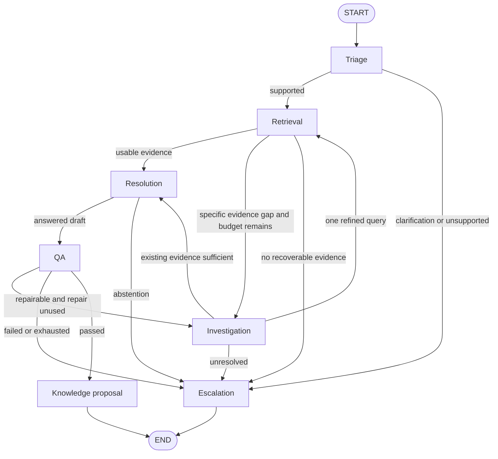

# Enterprise Support Intelligence Platform

Multi-agent RAG platform for enterprise customer support. The backend currently provides data
preprocessing, hybrid retrieval, grounded LLM response generation, and opt-in LangGraph orchestration.
The React + TypeScript frontend and PostgreSQL-backed persistence remain future work.

## Current status

- **Phase 0** — project structure, Python environment, dependency management, Ruff, mypy, pytest,
  pre-commit.
- **Phase 1** — shared raw preprocessing CLI with a notebook interface. The original 20,000 English
  tickets were split into 16,000 retrieval / 2,000 dev / 2,000 eval and remain unchanged.
- **Phase 2** — Qdrant Cloud knowledge base, PII redaction, dense + sparse + hybrid retrieval,
  retrieval API, and an offline retrieval evaluation harness. No local database or embedding model
  is required.
- **Phase 2 evaluation** — the approved 23-query pilot is complete; the full 150-query evaluation
  remains deferred. Retrieval metrics are LLM-judgment-based pooled estimates.
- **Phase 3** — retrieval-backed response generation is accepted as functionally complete.
  Independent semantic answer-quality evaluation remains deferred.
- **Phase 4** — the seven-node LangGraph workflow is implemented with local regression and failure-path
  validation. The live orchestration smoke test requires separate payload-specific approval.

## Phase 4: LangGraph multi-agent orchestration

The opt-in layer under `backend/app/agents/` exposes `POST /api/v1/orchestration/respond` while
preserving the standalone retrieval/generation services and endpoints. Seven small `StateGraph`
nodes use deterministic conditional routes; only Resolution calls the existing LLM service.
All phase planning and implementation notes remain in this README.

### Enablement and API

```bash
uv sync --extra orchestration --extra dev --extra data --locked
```

Set `ORCHESTRATION_ENABLED=true` in the server environment, then run the existing FastAPI app.
The endpoint returns 404 while disabled. The orchestration extra is loaded lazily, so the standalone
API can still run without LangGraph. CI installs the narrow orchestration extra, without requiring
the larger AI dependency bundle. The locked LangGraph version remains 1.2.24.

```json
{"query":"The account portal will not let me sign in","top_k":3,"mode":"hybrid"}
```

The request accepts existing retrieval filters and explicit provider selection. Extra fields such
as run budgets, graph routes, or arbitrary state are rejected. The response envelope includes
`outcome`, `reason`, a `response` only for a QA-passed answer, structural `qa_checks`, redacted
metadata-only `events`, run counters, timing, and an optional `knowledge_proposal`.
`semantic_quality_verified` is always false. HTTP 429 includes `Retry-After`; infrastructure failures
use 503, scope conflicts use 403, and unexpected programming failures use a sanitized 500.

`ORCHESTRATION_INVESTIGATION_ENABLED=false` and `ORCHESTRATION_KNOWLEDGE_ENABLED=false` select the
minimal workflow. Both optional nodes are enabled when the overall feature is enabled by default.
Server-only cap settings are documented in `.env.example`; callers cannot raise them.

### Shared state and service reuse

A versioned `TypedDict` carries Pydantic-validated work data and deduplicated events:

- Request: run/request IDs, redacted query, intent, urgency, language, and validated filters.
- Evidence: retrieval query/version, bounded redacted sources, ticket IDs, ranks, and context hash.
- Work: evidence-linked findings, explicitly separate hypotheses, draft `ResponseResult`, QA checks,
  routing reason, final outcome, and an optional knowledge proposal.
- Control: deadline, retrieval/draft/repair counters, provider-attempt and token budgets, pinned
  provider/model/prompt versions, sanitized errors, and a bounded event history.

Nodes own their work fields and return validated updates. Replace draft/evidence fields
on revision; use deterministic, event-ID-deduplicating reducers only for appendable events. Start
with sequential execution. Put service instances, credentials and trusted authorization context
in runtime dependencies, outside serializable state. The live deadline, token and I/O budget are
also runtime-owned; state/events expose counter snapshots rather than allowing agent-controlled
limits. State is request-scoped; defer
durable checkpoints to the PostgreSQL persistence work, including retention and replay controls.

Retrieval calls `QdrantTicketStore.search` and `fetch_payloads`, retaining the retrieval-split guard,
redaction, filters and context limits. Resolution calls `ResponseService.generate` on that evidence;
calling `respond` here would retrieve a second time. Reuse `bound_sources`, provider adapters and
their budgets. Keep the standalone Phase 3 endpoint working. Any extraction of shared validation
helpers must preserve its behavior. Pin explicit provider/model selection for the entire run.

### Seven agent responsibilities

| Agent | Responsibility and output |
| --- | --- |
| Triage | Validate/redact input; classify supported intent, urgency and language; request clarification or route unsupported cases. Start with rules. |
| Retrieval | Read the existing Qdrant collection; return bounded evidence with ticket provenance. No ingestion or reranking. |
| Investigation | Identify missing/conflicting evidence; produce evidence-linked findings or one bounded query refinement. Hypotheses cannot become facts. |
| Resolution | Generate a cited draft through the existing response service, or preserve its insufficient-evidence decision. No claimed account actions. |
| QA | Check schema, citation/source identity, quotations, context version and outcome consistency. Initially deterministic; quotation matching does not prove semantic correctness. |
| Escalation | Return a terminal clarification/escalation/unavailable outcome, reason and redacted handoff summary. No external ticket creation or mandatory human approval. |
| Knowledge | After QA passes, prepare a deduplicated, evidence-linked knowledge-gap/reuse proposal. QA approval alone cannot establish a new fact; no automatic corpus writes. |

### Routing



The minimal configuration routes QA success directly to END. In the full configuration, only a
QA-passed draft can become an answered outcome. Knowledge is best-effort and cannot invalidate that
answer. Use a workflow envelope with explicit `answered`, `needs_clarification`, `escalated` or
`unavailable` outcomes, carrying the existing response schema where applicable. Every conditional
route checks remaining visit, I/O and deadline budgets; exhaustion routes to Escalation. Preserve
HTTP 429/503 semantics and `Retry-After` for service failures. No indefinite loops.

### Failure bounds, security and observability

Enforced configurable caps: two retrieval passes, two draft attempts, one Investigation
visit/repair episode, four total LLM HTTP attempts including provider retries, a 120-second run
deadline, an explicit graph step limit of 16, and 12,000 estimated tokens by default. Reserve shared token/attempt budgets before I/O;
count nested service retries and respect remaining time. The provider layer owns transport retries;
do not stack whole-node generation retries on top. Retry only safe transient reads within budget.
Do not automatically resend uncertain LLM timeouts. Quota failures return `Retry-After` promptly;
auth/configuration failures stop immediately. Infrastructure failures yield `unavailable`, not a
fabricated support resolution. Log unexpected programming errors safely and return a sanitized 500.

Treat queries, tickets and agent outputs as untrusted data. Allowlist tools/routes and validate all
updates; model text cannot change budgets, authorization filters, provider settings or tool access.
Carry trusted access scope from the API boundary; never infer tenant access from ticket text. Keep
credentials and raw content out of state logs/traces. Preserve the existing corpus and reserved
evaluation split; introduce no paid APIs, autonomous actions, automatic knowledge ingestion or HITL.

Emit local structured events per run/node: route/reason, duration, attempt counts, token usage,
provider/model/prompt and graph versions, context hashes, QA results and terminal outcome. Keep
business content redacted and bounded. Reuse existing timing/usage fields; external Langfuse tracing
is optional later, without introducing a paid dependency or enabling content export by default.

### Incremental delivery and acceptance

1. **Contracts and skeleton:** confirm the locked LangGraph API; define state, outcome schemas,
   dependency injection, budgets and fake-node routing tests. No live LLM calls required.
2. **Small working graph:** implement Triage → Retrieval → Resolution → QA, plus terminal
   Escalation. Reuse current services; add the opt-in endpoint and compare against Phase 3 behavior.
3. **Bounded Investigation:** add one evidence-gap/refinement path; test useful recovery and forced
   termination. Add LLM investigation only if deterministic findings prove insufficient and its
   separate call fits the same run-wide budgets.
4. **Knowledge and hardening:** add proposal-only Knowledge, deduplication, failure isolation,
   trace summaries and a capped development pilot. Persistence and approved publishing come later.

Test shared-state validation/reducers, every route, empty/conflicting evidence, invalid citations,
prompt injection, access-filter preservation, quota/auth/timeout failures, deadline/step exhaustion,
retry amplification and request isolation. Assert that Knowledge cannot write to Qdrant and failed
QA cannot return an answer. Run existing API regressions and Ruff/mypy/pytest/notebook gates. Use
cached pilot evidence and mocked providers first; live tests remain explicitly capped and optional.
Acceptance requires deterministic routing, enforced bounds, traceable terminal outcomes and unchanged
standalone retrieval/generation behavior. The small retrieval pilot and structural QA do not replace
the deferred semantic answer-quality evaluation or establish production readiness.

Design references: [LangGraph Graph API](https://docs.langchain.com/oss/python/langgraph/graph-api)
for typed state, nodes, conditional routing and runtime dependencies, and
[Thinking in the Graph API](https://docs.langchain.com/oss/python/langgraph/thinking-in-graph-api)
for incremental workflow decomposition. The staged rollout guided implementation; the budgets above
are now enforced server defaults.

### Phase 4 implementation and validation

The four delivery increments are implemented: typed contracts and graph skeleton; the minimal
workflow; one deterministic Investigation path; and proposal-only Knowledge with failure isolation.
The 29 orchestration tests cover routes, repair exhaustion, real HTTP-adapter retry accounting with
mock transports, deadlines, concurrency, access-filter preservation, PII, metadata traces, and
standalone startup with the optional graph dependency unavailable. The complete local suite reports
**167 passed, 6 skipped**; the skipped tests are opt-in live Qdrant contracts. Ruff lint/format,
mypy (46 source files), notebook syntax, and whitespace checks passed. The local JUnit artifact is
`data/eval/phase4_local_tests.xml`; no customer payload was used in these tests.

Investigation only removes conversational boilerplate from the retrieval query, or requests one
draft repair after structural rejection. It never changes the original question passed to Resolution,
relaxes filters, or invents facts. Distinct resolutions for an identical issue text trigger a
conservative resolution-variance finding and investigation/escalation; this is not a semantic
contradiction classifier. Basic rule-based Triage is similarly not a general domain classifier.

QA checks the supplied source identities, exact quotations, current context version/hash, pinned
provider/model/prompt, and server-rendered answer consistency. It cannot approve a claim merely
because an LLM says it is correct. Independent semantic quality evaluation remains deferred.

Knowledge emits a stable proposal ID and source-ticket references only, with `status=unreviewed`
and `publication_allowed=false`. It has no publishing or persistence operation. Proposal failure
or exhaustion of an optional Knowledge step does not discard an already QA-passed answer.

Trusted filters enter through the `get_trusted_filters` API dependency and are intersected with
request filters, with conflicts rejected before I/O. Its default is an empty scope for this existing
single-corpus development deployment. An authenticated authorization layer must supply the scope
before any multi-tenant deployment; tenant isolation is not claimed by this implementation.

The response trace and local logging records contain node/route/reason, durations, attempt/token/read
counters, hashes, QA checks and reported draft usage, without question/ticket text. Configure the
`app.agents.graph` logger at INFO to consume these structured logging fields. Implicit LangSmith
export is disabled inside runs even if tracing is enabled externally; no external trace sink,
checkpoint store, durable memory or background worker is enabled.

The request deadline stops waiting for a synchronous worker thread. Its already-running HTTP call
may finish later; cancellation closes the run's I/O budget, preventing subsequent calls/retries.
Unknown remote completion is never automatically replayed. Standalone provider/retrieval requests
do not acquire graph budgets. A sentence-ending-period email-redaction gap found during testing was
fixed with a focused regression test; the corpus and saved Phase 2 judgments were not changed.

One live orchestration smoke request was prepared for `dev-q0005`, with at most three retrieved
tickets and the configured Groq model. Automatic approval review rejected its execution because
payload-specific authorization to send development query/ticket content to external Qdrant/Groq
services was required. **No live orchestration validation ran.** It remains pending explicit approval;
no provider/model substitutions or alternative execution paths were used to bypass that decision.
No code was committed or pushed as part of Phase 4 implementation.

## Repository layout

```text
.
├── backend/
│   ├── app/
│   │   ├── api/v1/          # REST API routes
│   │   ├── core/            # settings and cross-cutting concerns
│   │   ├── db/              # database session and base classes
│   │   ├── models/          # SQLAlchemy models
│   │   ├── schemas/         # Pydantic schemas
│   │   ├── services/        # application services
│   │   ├── agents/          # LangGraph agents
│   │   ├── retrieval/       # dense, sparse and hybrid retrieval
│   │   └── providers/       # LLM provider abstraction
│   └── tests/
├── data/
│   ├── raw/                 # downloaded source data (git-ignored)
│   ├── interim/             # intermediate artifacts (git-ignored)
│   ├── processed/           # standardized splits (git-ignored)
│   └── eval/                # evaluation-only artifacts (git-ignored)
├── notebooks/
│   └── 01_dataset_ingestion.ipynb
├── docs/
└── pyproject.toml
```

## Prerequisites

- Python 3.11
- [uv](https://docs.astral.sh/uv/)
- Git
- For data ingestion: a Kaggle account and API token (`~/.kaggle/kaggle.json`), or internet access
  for the Hugging Face fallback.
- For retrieval: a free Qdrant Cloud cluster URL and API key.

## Setup

```bash
uv sync --extra dev
```

This creates `.venv` with the backend and development tooling. Optional extras are installed only
when needed:

- `data` — pandas, pyarrow, scikit-learn, Kaggle/Hugging Face downloaders, plotting. Needed for
  local notebook runs and split validation.
- `retrieval` — pandas and pyarrow only. Needed to run the Qdrant ingestion script locally.
- `notebook` — JupyterLab and ipykernel. Needed only for local notebook execution.
- `orchestration` — the narrow LangGraph runtime extra for Phase 4 and its tests.
- `ai` — the broader optional LangGraph/LangChain/Langfuse/RAGAS/Redis bundle.

Local data processing:

```bash
uv sync --extra data --extra notebook --extra dev
```

AI development:

```bash
uv sync --extra ai --extra data --extra notebook --extra dev
```

## Quality gates

```bash
uv run ruff check .
uv run ruff format --check .
uv run mypy
uv run pytest
uv run python scripts/check_notebooks.py
```

Install the hooks once:

```bash
uv run pre-commit install
```

## Data pipeline

Source: [`tobiasbueck/multilingual-customer-support-tickets`](https://www.kaggle.com/datasets/tobiasbueck/multilingual-customer-support-tickets)
(CC BY 4.0), mirrored on Hugging Face as `miku1211/customer-support-tickets`.

The supported entry point is `processor.py` (or the installed `support-preprocess` command).
`notebooks/01_dataset_ingestion.ipynb` delegates to the same package; it requires the repository
package to be installed. No processing logic or numeric tuning constants are duplicated in cells.

Outputs:

- `tickets_retrieval.parquet` — 16,000-record historical retrieval corpus.
- `tickets_dev.parquet` — 2,000 records for prompt and retrieval tuning.
- `tickets_eval.parquet` — 2,000 held-out records for evaluation.
- `data_quality_report.json` — cleaning counts, distributions, duplicate statistics, leakage check.
- `split_manifest.json` — row counts and SHA-256 checksums.
- `split_isolation.json` — checksum-bound hashed ID/issue/group membership for later isolation checks.

The evaluation split is quarantined and must never be ingested into Qdrant.

New runs write only to fresh directories under `data/preprocessing_runs/`; existing outputs are
never overwritten. The original `data/processed/` artifacts remain untouched. Example workflow:

```bash
uv sync --extra data --extra retrieval --extra dev --extra orchestration --locked
uv run --extra data --extra retrieval python processor.py --input data/raw/tickets.csv --dry-run
uv run --extra data --extra retrieval python processor.py --input data/raw/tickets.csv --output-dir data/preprocessing_runs/my_new_run
uv run --extra data --extra retrieval python scripts/validate_splits.py --processed-dir data/preprocessing_runs/my_new_run
```

On Windows, `commands.cmd --input data/raw/tickets.csv --dry-run` runs the same CLI. It never runs
Qdrant ingestion. `--retrieval-rows`, `--dev-rows`, `--eval-rows` and `--seed` provide explicit run
overrides. An optional public Hugging Face source uses `--hf-dataset owner/dataset --revision SHA`;
SHA must be an exact 40-character commit. There is no implicit latest revision or credential-bearing
download. Local CSV and single-CSV ZIP inputs are supported without extracting archive paths.

### Central configuration and data isolation

`app.core.config.PreprocessingSettings` reads validated `PREPROCESS_*` settings from `.env`.
It centralizes source/input paths, target languages, schema aliases, normalization maps, split sizes,
seed, query-length bounds, duplicate grouping, output location, and indexing-text budgets. Defaults
remain 16,000/2,000/2,000 rows, seed 42, English, query lengths 20..20,000 characters, and a lexical
duplicate similarity threshold of 0.88. `.env.example` lists the operational settings. The runtime
Qdrant settings remain in `app.core.config`.

Preprocessing settings and their default maps now also live in `core/config.py`, matching the
repository working rules. The old `preprocessing/config.py` contains an import-only compatibility
shim; internal code and the notebook import the central definition. `PREPROCESS_*` environment
names and existing behavior are preserved. Legacy validation remains fail-closed until trustworthy
metadata from the original split creator is supplied; no evaluation data is opened to recreate it.
The user explicitly chose to keep that validation blocked and provide the manifest later.
The configuration-consolidation follow-up passed three focused tests and a single full-suite run
of **189 passed, 6 skipped**; the compatibility import and `PREPROCESS_*` prefix are regression-tested.

Before splitting, the pipeline removes exact duplicates and groups identical normalized issues,
including issues with different historical answers. Additional lexical near-duplicate grouping uses
stateless hashing features and batched cosine-radius queries, without fitting a vocabulary or IDF
on future held-out records. All detected neighbors are considered, not just the first ten. Grouping
features are discarded; pretrained embeddings are not trained on this data. Whole groups belong to
one split only. Impossible target sizes fail rather than splitting a group or silently exporting
partial datasets. This is lexical grouping, not proof that every semantic duplicate was detected.

During initial split creation, the sidecar records hashed ticket, normalized-issue and group
membership for all three splits. Evaluation Parquet bytes are serialized and hashed in memory
before their first write. Later validation opens only retrieval/dev files and the bound metadata;
indexing opens only retrieval. Both reject evaluation paths, including in dry-run mode. Per-row split
metadata and file checksums must match the sidecar. These checks prevent accidental leakage under
the recorded partition; the manifest is a trusted local artifact, not a cryptographic signature.
The held-out file's digest is recorded at creation; routine validation deliberately does not reopen
its bytes to re-check later file integrity.

**Legacy limitation:** the original split manifest has no isolation sidecar. Validation/indexing
therefore fails closed for that legacy export; it never falls back to reading evaluation data.
The authorized local audit on 2026-11-25 found five development and seven evaluation questions
matching retrieval after Unicode, whitespace and case normalization. A separate repaired export
now lives in `data/preprocessing_runs/legacy_clean_20261125/`: **16,000 retrieval, 1,995 development,
and 1,993 evaluation records**. It preserves the retrieval file byte-for-byte and excludes only
those overlapping held-out rows. All original files and the Qdrant collection remain unchanged.
Its checksum-bound `split_manifest.json`, `split_isolation.json` and `cleanup_report.json` record
the source checksums, exclusions, retained membership and benchmark impact. No sidecar was attached
to the original export. The existing 150 development queries and 23-query pilot contain none of
the affected questions; their existing results remain LLM-judgment-based pooled estimates.
This repair verifies recorded IDs, normalized questions and existing groups, not semantic
equivalence across all tickets. The evaluation file was read only for this explicitly authorized
repair; routine validation and ingestion retain their quarantine guards. Use the repaired directory
for subsequent offline split validation; no re-indexing is needed:

```powershell
uv run --no-sync python scripts/validate_splits.py --processed-dir data/preprocessing_runs/legacy_clean_20261125
```

The repair implementation is `app.preprocessing.clean_legacy`; it requires explicit source and
fresh destination paths plus `--authorize-heldout-read`. It is a maintenance operation, not part
of routine ingestion, and must not be rerun on held-out data without authorization.

Raw text is normalized and pattern-based PII redaction is applied before new exports. Ticket
resolution status is still explicitly recorded as inferred from a non-empty historical answer;
this does not independently prove that the customer's issue was resolved. Original timestamps are
not invented. Source locators, source checksums, inferred-status policy, seed and settings are
recorded for reproducibility.

### Token-aware indexing text

The new offline profile is `minilm-wordpiece-v2`. It keeps one ticket per point; no overlapping
chunk splitter is introduced. Dense input remains subject + issue, with at most **256 WordPiece
tokens including special tokens**. Full redacted ticket fields remain in the payload. Sparse input
includes the issue and resolution with a default **2,048-reference-token** safety budget, reserving
half for each section so a long issue cannot crowd out its resolution. This count uses the same
reference WordPiece tokenizer; it is not a claim about BM25's internal tokenization or an empirically
optimal sparse limit. Original/retained token counts and truncation flags are recorded and aggregated
in new ingestion reports. Unicode and punctuation are handled using tokenizer offsets, not character
estimates.

The small tokenizer JSON is bundled for offline use; no generative/embedding model weights are
downloaded or run locally. Asset source: `sentence-transformers/all-MiniLM-L6-v2`, revision
`1110a243fdf4706b3f48f1d95db1a4f5529b4d41`, Apache-2.0 model-card license; SHA-256
`be50c3628f2bf5bb5e3a7f17b1f74611b2561a3a27eeab05e5aa30f411572037`.
The loader verifies that checksum and disables tokenizer-side hidden truncation before counting.
Other embedding models require a separately validated tokenizer profile. The tokenizers dependency
is locked under the retrieval extra; `pyproject.toml`/`uv.lock` remain the dependency sources.

### Ingestion hardening verification

Python 3.11.9 and the existing virtual environment were validated and synchronized against the lock.
The earlier apparent missing interpreter was a sandbox-access restriction, not a missing Python
installation; no global reinstall was needed. CLI help and the installed `support-preprocess`
entry point work. The bundled tokenizer runtime is tokenizers 0.22.2.

The complete local suite passed **188 tests**, with six live Qdrant tests skipped. The new synthetic
tests cover deterministic splits; no shared learned vocabulary/IDF; cross-split ID, issue and cluster
leakage; more than ten near-duplicate neighbors; impossible group allocations; wrong split metadata;
missing/tampered sidecars; evaluation-read traps during validation and dry-run ingestion; tokenizer
limits including Unicode/special tokens; resolution retention; pinned public-source revisions;
non-overwriting exports; and protection of the existing Qdrant collection. Ruff, formatting, mypy
(52 source files), and notebook syntax checks passed. No real preprocessing, embedding, indexing,
or LLM calls were run. Original retrieval/dev and evaluation-pilot artifact hashes were checked
unchanged; the reserved evaluation file was neither opened nor modified. No commit or push was made.

## Retrieval index

The retrieval corpus is stored in Qdrant Cloud. Embeddings are generated with Qdrant Cloud
Inference (`sentence-transformers/all-minilm-l6-v2` and `qdrant/bm25`), both free models, so no
embedding model or vector database is installed on the application host.

1. Create a free Qdrant Cloud cluster.
2. Put the cluster URL and API key in `.env` (see `.env.example`).
3. Install the ingestion dependencies:

   ```bash
   uv sync --extra retrieval --extra dev
   ```

4. For a NEW export with an isolation sidecar, validate/prepare without connecting (replace `NEW_RUN`
   with its actual directory):

   ```bash
   uv run --extra retrieval python scripts/ingest_qdrant.py --input NEW_RUN/tickets_retrieval.parquet --manifest NEW_RUN/split_manifest.json --dry-run
   ```

5. The existing `support_tickets_v1` collection is already populated; do not re-index it. Future
   token-aware writes require an explicitly named new collection. The CLI refuses both the configured
   existing corpus and destinations that already exist; `--recreate` is no longer supported.

The script verifies the retrieval checksum from `split_manifest.json`, rejects unresolved or
non-English rows, and checks held-out isolation through the sidecar without reading held-out files. It writes
`data/processed/qdrant_ingestion_report.json`.

Run the API:

```bash
uv run uvicorn app.main:app --reload
```

Endpoints:

- `POST /api/v1/retrieval/search` — `dense`, `sparse` or `hybrid` retrieval (`hybrid` is the default
  and fuses dense + BM25 with RRF).
- `GET /api/v1/retrieval/health` — collection readiness, document count and dimension validation.
- `GET /health` — root-level liveness probe.

Search modes:

```json
{"query": "account portal offline", "top_k": 5, "mode": "dense"}
{"query": "account portal offline", "top_k": 5, "mode": "sparse"}
{"query": "account portal offline", "top_k": 5, "mode": "hybrid"}
```

Use the dev split for proxy checks only:

```bash
uv run python scripts/dev_retrieval_check.py --limit 20 --top-k 5
```

The eval split is never used by the retrieval pipeline.

## Retrieval evaluation

Retrieval quality is measured offline against LLM-generated relevance judgments, with a small manual
verification sample. Dense, sparse and hybrid modes are scored on the same query set and the same
judgments. Metrics are pooled-relevance estimates, not human ground truth and not absolute corpus
recall.

```bash
uv run python scripts/build_dev_queries.py --limit 150
uv run python scripts/build_candidate_pool.py --depth 10
uv run python scripts/generate_qrels.py --queries-limit 10 --max-pairs 60   # pilot
uv run python scripts/generate_qrels.py                                     # full run, resumable
uv run python scripts/verify_qrels_sample.py --size 20
uv run python scripts/evaluate_retrieval.py --modes dense,sparse,hybrid
uv run python scripts/benchmark_latency.py --warmup 5 --repeats 30
```

All evaluation artifacts are written to git-ignored `data/eval/`. Judging requires a free Groq or
Gemini key in `.env`. See [`docs/evaluation.md`](docs/evaluation.md) for the full methodology, the
qrels format, the evaluation policy and its limitations.

## Important notes

Phase 3 response generation is implemented at `POST /api/v1/responses/generate`.
It uses the existing retrieval service, returns ticket citations with verified
source quotations, and abstains when usable evidence is absent or output fails
validation. `GET /api/v1/responses/providers` shows configuration status. Groq is
the default; alternatives require explicit enablement and selection. See
[`docs/generation.md`](docs/generation.md) for configuration, API behavior,
bounded evaluation, and limitations.

- Generated ticket identifiers are UUIDs. Source provenance is preserved separately in
  `source_ticket_id` and the `metadata` JSON column.
- No local vector database or embedding model is installed. Qdrant Cloud stores vectors and payload;
  Qdrant Cloud Inference generates dense and BM25 vectors.
- `all-MiniLM-L6-v2` is the selected compact, free Qdrant-hosted English embedding model, producing
  384-dimensional vectors. It is not the only free model available. Other embedding choices require
  their own tokenizer/profile validation and separate retrieval evaluation; no model migration or
  re-indexing was performed during ingestion hardening.
- Cross-encoder reranking (`BAAI/bge-reranker-base`) is **not implemented**. It is deferred until the
  hybrid baseline has been measured.
- PII redaction is regex-based and limited to email, URL and phone-like patterns. It is a safety net,
  not a compliance product.
- Human-in-the-loop approval is intentionally **not** part of this design. The workflow is
  autonomous, with QA as the final gate and escalation as a terminal outcome. The manual verification
  worksheet is offline evaluation QA, not HITL.
- No paid LLM APIs or local generative models are introduced. The Phase 3 runtime
  uses configured free-tier providers separately from the offline judge.
